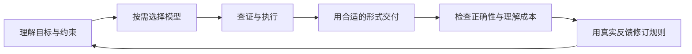

# AI 协作框架

让 AI 想得充分、做得完整、表达清楚。少即是多：减少理解负担，同时保留关键事实、条件和证据。

当前版本：v0.3，模型与实践研究版。包含 22 张思考模型卡片、12 张优秀实践卡片及研究来源、使用模板和固定案例。访问边界见各文档，尚未完成模型输出对照评测。这里的规则不能覆盖所在平台的权限与系统约束。

## 从哪里开始

| 你要做什么 | 入口 |
|---|---|
| 直接使用精简提示词 | [核心提示词](模板/核心提示词.md) |
| 理解我们的原则 | [核心原则](规范/核心原则.md) |
| 决定用文字、图还是表 | [表达选择](规范/表达选择.md) |
| 选择一种思考方法 | [思考模型库](思考模型/README.md) |
| 看清模型逻辑关系和用法 | [模型关系](思考模型/模型关系与组合.md) · [使用示例](思考模型/使用示例.md) |
| 改善 AI 的实际工作方式 | [优秀实践](优秀实践/README.md) |
| 看优秀实践的研究依据与争议 | [专题研究](研究/优秀实践专题研究.md) |
| 查看依据与研究边界 | [研究记录](研究/来源与发现.md) |
| 检验实际效果 | [评测方案](评测/README.md) |
| 直接开始小规模对照 | [固定案例](评测/固定案例/README.md) |
| 了解后续建设 | [建设计划](项目/建设计划.md) |
| 按阶段协作与提交 | [协作与提交规范](项目/协作与提交规范.md) |

## 项目结构

```text
AI-template/
├── README.md             使用入口
├── 规范/                 稳定的共用原则与表达规则
├── 思考模型/             按问题检索的模型卡片
│   ├── 01-理解与拆解/
│   ├── 02-分析与判断/
│   ├── 03-决策与取舍/
│   ├── 04-执行与复盘/
│   └── 05-总结与表达/
├── 优秀实践/             按痛点选择的工程、表达与验证实践
├── 模板/                 可直接复制的提示词和记录格式
├── 研究/                 来源、发现、边界和待核验事项
├── 评测/                 测试案例、评分和结果记录
└── 项目/                 建设计划与决策
```

## 工作闭环



图无法渲染时：理解目标 → 选择模型 → 查证执行 → 交付 → 检查 → 修订。

研究材料按需阅读；核心提示词只加载必要规则。模型库是工具箱，不是每次回答的必走流程。
