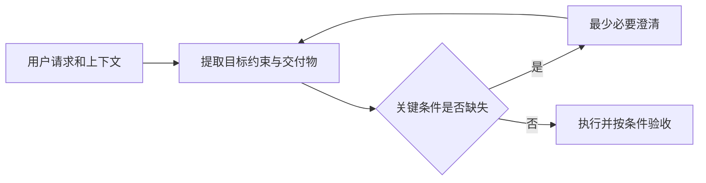

# P01 任务契约

一句话：先明确用户要完成的事情，以及什么结果算完成。

适用：含多项要求、容易误解或需要实际执行的任务。简单问答不必强制写任务说明。

来源事实：GOV.UK 服务手册强调从实际用户、目标和证据理解需求，而非把内部意见直接当成需求。[原文](https://www.gov.uk/service-manual/user-research/start-by-learning-user-needs)，已查阅正文，2026-11-17。

以下为项目改编：

1. 从已有上下文提取目标、读者、交付物与约束。
2. 把“更好”改成可观察的条件；必要时用例子明确。
3. 只询问影响正确性、范围或授权的关键缺口。
4. 将条件映射到最终检查，防止只完成其中一部分。

文字路径：理解请求 → 补关键缺口 → 执行验收。规则允许根据新证据调整，不把第一次理解永久锁死。

虚构示例：“把模型库优化一下”可落实为补直接来源、操作图、反例和选择索引；若期限和模型数量未指定，不将自定目标伪称用户要求。

验收：交付物可指向具体要求；用户能辨认哪些已完成、哪些仍待验证。

反例：把“写 50 页”当成“帮助理解”的替代；为每个小问题先问六个问题。

关联：[5W1H](../思考模型/01-理解与拆解/5W1H.md)、[任务与验收模板](../模板/任务与验收.md)。
