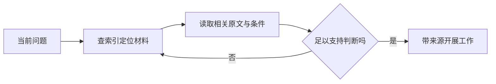

# P02 按需上下文

一句话：让当前任务获得必要材料，并保留回查原文的入口。

适用：资料库、长文档或跨会话工作；涉及精确条款、跨文档冲突时不能只看摘要。

来源事实：Anthropic 将上下文组织视为工程问题；《Lost in the Middle》在所测试的长上下文任务中发现相关信息位置会影响表现。[工程文章](https://www.anthropic.com/research/effective-context-engineering-for-ai-agents)已读正文，[论文页面](https://aclanthology.org/2024.tacl-1.9/)仅摘要与元数据，2026-11-17。旧模型结果不直接代表当前所有模型。

项目操作：

1. 先读目录、索引和任务相关摘要，定位材料。
2. 加载支持当前判断的原文及必要上下文。
3. 记录来源、日期、版本与冲突，区分事实和摘要解释。
4. 执行中出现缺口再补材料，不把“少加载”当硬目标。

文字路径：问题 → 定位 → 原文 → 补缺或行动。摘要是导航，不能替代关键证据。

虚构示例：解释 PDCA 时读取对应卡片和来源；比较所有方法时读取索引、关系地图与候选卡片，而非仅凭一段短摘要分类。

验收：重要判断可回查；没有为了节省上下文漏掉决定性条件。记录遗漏、耗时与工具成本后再评估这种做法是否有益。

反例：把整个仓库塞进每次提示；反过来只给一句摘要却要求精确比较。
