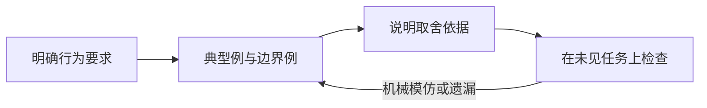

# P03 示例与反例

一句话：用任务相关的好例子、反例和边界解释抽象要求。

适用：语气、结构、字段、分类标准难以只用一句规则表达时。

来源事实：Claude 官方提示文档建议使用相关且多样的示例辅助约束输出。[原文](https://platform.claude.com/docs/en/build-with-claude/prompt-engineering/claude-prompting-best-practices)，已查阅相关正文，2026-11-17。属于厂商建议，应在目标模型上验证。

项目操作：先定义目标；选择典型、边界和容易混淆的情况；解释哪里好、哪里不符合；把训练用样例与留出评测分开。

| 要求 | 反例 | 较好示例 | 为什么 |
|---|---|---|---|
| 简洁且完整 | “已完成” | “已新增 3 张卡片并检查链接；来源正文待核验。” | 信息短，但完成边界明确 |
| 按需画图 | 单个定义也画五节点图 | 一句定义；流程复杂时再画图 | 形式服务理解 |

文字路径：规则 → 样例与解释 → 新任务检验 → 修订。样例数量并非越多越好。

虚构示例：同一组示例同时包含“短问题短答”和“复杂任务保留必要细节”，防止模型学成一律短答。

验收：新任务仍满足要求，未照抄示例中的虚构事实、日期或数字。

反例：样例全是同一种格式，最终所有回答都变成表格；用测试答案当提示例子后再宣称泛化提高。
