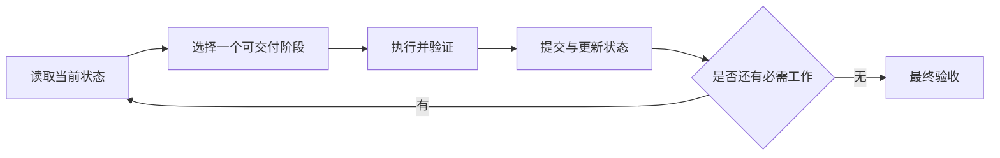

# P04 增量执行与交接

一句话：长任务每阶段留下可检查结果和可接续状态。

适用：跨会话、多人协作、持续编辑项目；几分钟的小任务不需要额外报告体系。

来源事实：Anthropic 的长任务工程实践记录了增量工作、进度文件与 Git 检查点的作用。[原文](https://www.anthropic.com/research/effective-harnesses-for-long-running-agents)，已查阅正文，2026-11-17。案例依赖其模型与运行环境，不是普遍效果保证。

项目操作：

1. 按独立交付物分阶段，写出每段的完成条件。
2. 开始前检查当前状态，防止重复已有工作。
3. 完成一段后验证、提交，记录证据和剩余问题。
4. 交接时保留目标、约束、文件入口、已完成与下一步；不可只写“继续”。

文字路径：读状态 → 做一阶段 → 验证提交 → 接续或验收。并行可行时按依赖组织，不强制所有工作串行。

虚构示例：模型库分成既有卡片核验、新卡片、导航与检查三次提交，最终核对远程提交。提交成功不等于研究内容已经正确。

验收：接手者能从记录定位下一步；本地提交与远程同步分别报告。

反例：半成品没有状态记录；没有验证就把任务标完成；为追求提交数量拆成不可理解的碎片。

工具：[阶段交接模板](../模板/阶段交接.md)、[提交规范](../项目/协作与提交规范.md)。
