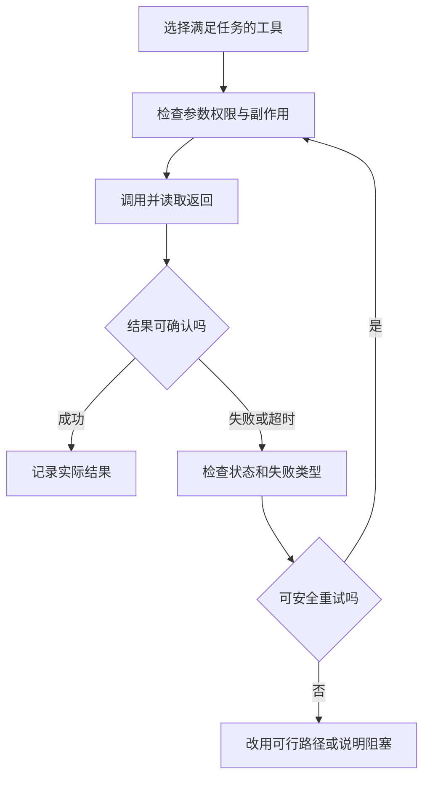

# P05 工具契约与恢复

一句话：让工具职责、参数、返回结果和失败恢复都清楚。

适用：为 AI 接入检索、文件、应用操作或设计调用流程；只有文字回答时不必引入工具。

来源事实：Anthropic 工具设计实践强调职责明确、返回相关信息和通过评测改进接口。[原文](https://www.anthropic.com/research/writing-tools-for-agents)，已查阅正文，2026-11-17。

项目操作：说明何时调用、必要参数、权限、副作用、成功状态与失败原因。查询先筛选和分页；错误应帮助修正参数或选择其他路径。可能产生重复副作用的操作，重试前先检查实际状态。

文字路径：选择 → 检查 → 调用 → 确认；失败先核对状态，再决定是否重试。

虚构示例：保存文件超时，先读目标位置确认是否已保存；不能因没有收到响应就断定未执行。

验收：能区分参数错误、权限不足、服务失败和结果未知；不会把错误文本当业务数据。

反例：把全部 API 原样暴露成几百个重叠工具；为节省返回长度删掉决定性状态；盲目重试写操作。

边界：权限和重试规则需由真实系统提供，提示词不能自行创造权限或保证幂等。
