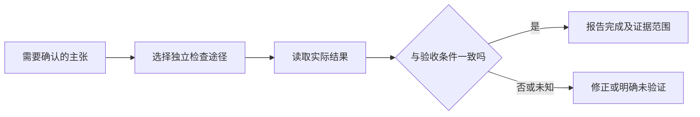

# P06 外部验证与验收

一句话：用原始材料、计算、测试或实际状态证明结果，而不只让 AI 再看一遍答案。

适用：事实研究、计算、代码、文件修改与外部操作；检查力度与错误后果匹配。

来源事实：《Large Language Models Cannot Self-Correct Reasoning Yet》讨论了缺少外部反馈的自纠在所测推理任务中的局限。[作者论文页](https://arxiv.org/abs/2310.01798)，仅查阅摘要与元数据，2026-11-17。不能据此断言当前模型一概不能自纠。

项目操作：

| 主张 | 优先证据 | 不足以证明 |
|---|---|---|
| 数字正确 | 独立计算、单位与输入核对 | 模型重复同一个数字 |
| 来源支持结论 | 原文与适用条件 | 只有一个看似相关的链接 |
| 文件已修改 | 实际差异与内容检查 | 回答中贴了一段建议文本 |
| 已同步远程 | 远程状态与提交核对 | 本地提交成功 |

文字路径：主张 → 选证据 → 核对 → 完成或修正。独立检查也可能有缺陷，需要与任务对应。

虚构示例：Mermaid 解析通过，报告“语法有效”；没有查看渲染结果时，不宣称视觉排版已验收。

验收：关键主张有对应证据，未知状态没有伪装成成功。

反例：让同一模型以同一材料自评三次，就称三次独立验证；测试只镜像实现而未检查用户需求。
