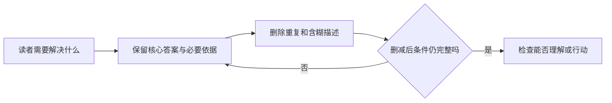

# P07 面向读者的编辑

一句话：按读者要理解、判断或执行的事情删改内容。

适用：解释、报告、总结与操作指南。故事、教学推导或用户指定顺序可以采用不同结构。

来源事实：Google 技术写作课程强调清楚的主体、具体动词和可核实描述。[原文](https://developers.google.com/tech-writing/one/clear-sentences)，已查阅正文，2026-11-17。英语句式细节不直接作为中文硬规则。

项目操作：先写核心答案，再按需要补理由、条件和动作。每段处理一个意思；删除客套、重复和无依据的修饰。读者需要比较时用共同维度，不把长段落硬塞进表格。

| 编辑前：虚构示例 | 编辑后 |
|---|---|
| 我们将积极推进全面优化，持续提升整体质量 | 本轮核验 5 张高频卡片的来源，并记录发现的定义错误 |
| 这个方案非常优秀，能显著提升效率 | 方案减少了一个手工步骤；整体耗时是否降低仍需测试 |

文字路径：读者任务 → 必要内容 → 删冗余 → 保完整 → 检查可用性。

验收：读者能指出结论、适用条件与下一步；短答没有牺牲必要解释。可通过查找或复述任务观察，不只统计字数。

反例：删掉限制让答案更有气势；每句都分点破坏推导；一句话已足够却增加总结表。

关联：[表达选择](../规范/表达选择.md)、[结论与支撑](../思考模型/05-总结与表达/结论与支撑.md)。
