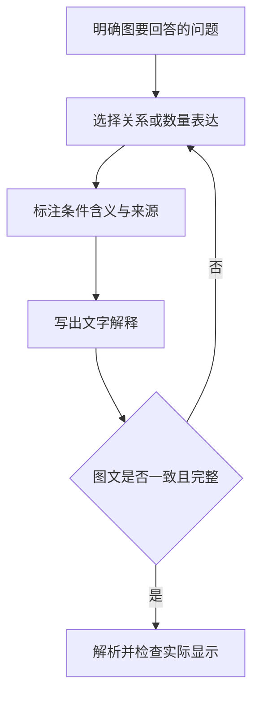

# P08 图表与文字等价

一句话：图表中的关键关系，应该能被文字准确解释并与材料核对。

适用：流程、结构、因果假设、决策分支及数量比较。单一事实不必画图。

来源事实：W3C WAI 对复杂图片建议提供识别说明与表达关键内容的详细文字替代。[原文](https://www.w3.org/WAI/tutorials/images/complex/)，已查阅正文，2026-11-17。Markdown 的一句路径并不自动满足所有网页无障碍要求。

项目操作：先定义图要回答的问题，再确定箭头代表时间、依赖、候选因果还是反馈。决策分支标条件，统计图保留口径和单位。正文写出主要路径与例外；图复杂时补表或详细说明。

文字路径：问题 → 图形 → 语义 → 文字核对 → 语法与显示检查。解析通过和视觉检查是两项工作。

虚构示例：“审核通过后发布”不能画成审核与发布无条件并行；应有“是否通过”分支，未通过返回修改。文字同时说明这个回路。

验收：遮住图也能从文字理解核心逻辑；图文没有相反的条件或顺序；无法确认的因果标为假设。

反例：箭头没有含义；仅靠红绿颜色区分状态；图显示所有失败都能重试，正文却限制为只读操作。
