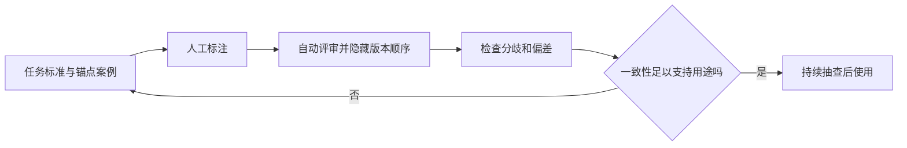

# P10 评审校准

一句话：先让评价标准与真实任务对齐，再让人工和自动评分对齐。

适用：比较提示词、模型或版本；有可检查事实的部分优先直接核对。

来源事实：MT-Bench/Chatbot Arena 的评审研究讨论位置、冗长和自偏好等偏差。[作者论文页](https://arxiv.org/abs/2306.05685)，仅查阅摘要与元数据，2026-11-17。特定实验中的一致性不能迁移成任何评审模型的准确率。

项目操作：

1. 写出准确、完整、清楚等维度的具体通过与失败例子。
2. 隐藏版本、交换回答顺序，允许平局和无法判断。
3. 先由人工标一小批；自动评分若与人工分歧，检查标准、证据和偏差。
4. 硬错误先判定，不能让格式分抵消事实编造。
5. 定期抽查分歧与失败记录，不让总分遮住退步。

文字路径：标准 → 人工锚点 → 自动评价 → 校准 → 抽查。这里的顺序隐藏指候选答案，不改变原始任务内容。

虚构示例：短回答准确完整，长回答更漂亮但编造来源，应判长回答失败；不能因为有图有表就加分。

验收：评审能指出具体证据；评分波动和分歧被记录；不强制“总要选一个”。

反例：让生成答案的同一模型未经校准就给自己打高分；把每次细微分数差都解释为真实改善。
