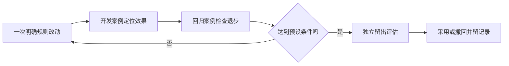

# P11 回归与留出案例

一句话：同时检查新能力和旧能力，并用没参与调优的案例检查过拟合。

适用：修改共用规则、示例、模型或工具后；文案细改可做对应检查，不必运行所有昂贵测试。

来源事实：Anthropic 代理评测实践区分能力与回归，强调可检查的任务结果和评审质量。[原文](https://www.anthropic.com/research/demystifying-evals-for-ai-agents)，已查阅相关正文，2026-11-17。下述分组和流程为项目设计。

项目操作：固定任务、材料、条件和通过标准；准备正反场景，例如“应该画图”与“不需要画图”。已知失败用于开发，稳定通过题用于回归，另保留未进入示例或调优过程的题。多次运行观察波动；正式对照前不把留出题反复用于改提示。

文字路径：开发 → 回归 → 满足条件后留出检查 → 记录决策。失败后可继续研究，但已看过的留出题不再视为全新。

虚构示例：“更简洁”规则改善短答，却让复杂计划丢负责人，应保留失败记录并修正；平均字数下降不能补偿遗漏。

验收：同一案例可复查；输入、输出和版本留存；未执行的对照不写“效果提升”。

反例：每版临时换题；只有应该触发某行为的题；把全部固定题公开用于示例后仍称独立留出。

入口：[固定案例](../评测/固定案例/README.md)、[实验记录](../模板/实践实验记录.md)。
