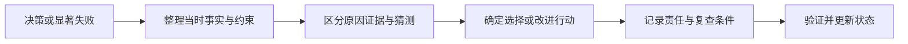

# P12 复盘与决策记录

一句话：留下当时为什么这样做，以及出错后实际改了什么。

适用：影响后续结构或行为的重要选择、反复错误与显著失败；小修改用提交消息即可。

来源事实：Google SRE 以事实和预防行动组织无责复盘；Michael Nygard 的 ADR 实践记录决策背景、状态、选择与后果。[SRE 原文](https://sre.google/sre-book/postmortem-culture/)、[ADR 原文](https://cognitect.com/blog/2011/11/15/documenting-architecture-decisions)，已查阅相关正文，2026-11-17。迁移到本项目是实践改编。

项目操作：

| 记录 | 要回答什么 | 避免什么 |
|---|---|---|
| 决策记录 | 当时问题、备选、约束、选择、代价、改变条件 | 把当前偏好伪装成永远正确 |
| 失败复盘 | 预期、实际、时间线、影响、原因证据、行动 | 责怪个人或只写“加强意识” |

文字路径：事件 → 事实 → 分析 → 行动 → 复查。后续改变决策时保留原背景，并标明被哪项新决定替代。

虚构示例：选择按问题分类，因为新读者不知道模型名；如果后来读者主要按方法名查找，可补名称入口，不必否认原来的使用背景。

验收：每个重要改进能检查落实情况；复盘结论有材料支持；记录不过度暴露敏感信息。

反例：每次失败只增加一条永久禁令；把“无责”理解为没有负责人；重复总结却没有检查行动效果。

关联：[AAR](../思考模型/04-执行与复盘/AAR.md)、[A3](../思考模型/04-执行与复盘/A3问题解决.md)。
