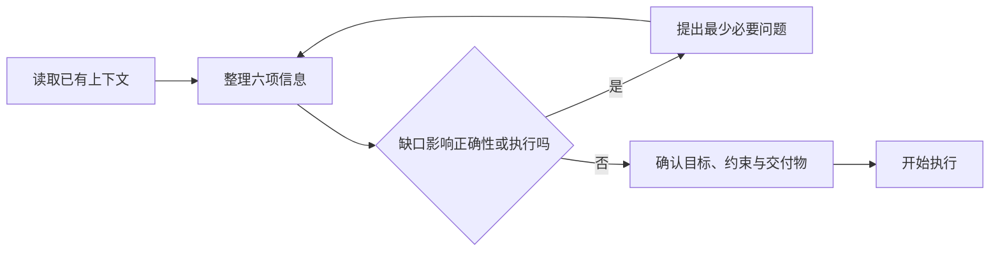

# 5W1H

> 用 Who、What、When、Where、Why、How 补齐事件或任务的基本信息。

类型：提问清单。状态：六项问题已核验；任务模板为项目改编。核验日期：2026-11-17。

## 何时使用

适合需求澄清、任务交接、事件描述；不用于独立证明原因。输入是已有上下文、用户目标及关键缺口，已知内容不必重复询问。

## 步骤与逻辑

| 问题 | 要记录什么 |
|---|---|
| What 什么 | 问题、交付物和验收条件 |
| Why 为什么 | 目标、价值；原因尚不明确时标为假设 |
| Who 谁 | 用户、负责人、相关方 |
| When 何时 | 时间范围、期限、顺序 |
| Where 何地 | 发生位置、系统、场景或范围 |
| How 如何 | 当前过程、实现方式与资源 |

先从上下文填充，再找影响执行的缺口；只追问必要信息。涉及预算、数量、规模时可扩展为 5W2H，增加 How much / How many。

文字路径：读上下文 → 整理六项 → 补关键缺口 → 执行。

## 虚构示例

“周五前给新同事一份部署指南”：Who 是新同事，What 是指南，When 是周五；还需确认部署到哪个系统。若仓库已经明确系统，直接使用上下文，不再询问。

输出：一句清楚的任务描述与必要约束清单。

## 误用与衔接

不要为了填满六格捏造信息；Why 的回答可能只是动机或假设，不等于根因。信息齐备就停止澄清，进入执行；复杂范围再用[问题树](问题树与MECE.md)。

## 来源

[Giveme5W1H，2019，作者论文摘要](https://arxiv.org/abs/1909.02766)，已查阅摘要，用于确认六项提问；不将其事件抽取实验效果迁移为本模板效果。[ASQ Problem Solving](https://asq.org/quality-resources/problem-solving)，已查阅网页，包含 5W2H 扩展说明。
