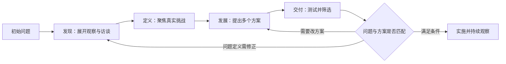

# 双钻模型：先找对问题，再探索方案

一句话：先发散理解问题、收敛定义挑战，再发散探索方案、收敛测试交付。

类型：设计与创新过程框架。基础定义已核对 Design Council 正文；下述操作与案例为项目改编。

## 适用边界

- 适用：用户问题和解决方案都不明确，容易直接跳到开发的时候。
- 不适用：明确的小修复不必重复完整调研；紧急事件先控制影响。
- 输入：受影响的人、已有观察、资源与约束。起初的需求描述可以是待验证假设。

## 怎么做

| 阶段 | 思考方向 | 操作 | 产物 |
|---|---|---|---|
| Discover 发现 | 发散 | 观察、访谈、查资料，理解不同人的实际困难 | 证据与问题线索 |
| Define 定义 | 收敛 | 综合证据，确定优先解决的挑战与成功条件 | 清楚的问题陈述 |
| Develop 发展 | 发散 | 提出多种方案，与使用者共同探索 | 多个可测试方案 |
| Deliver 交付 | 收敛 | 小规模测试，改进或淘汰，再实施 | 经测试的方案与限制 |

## 逻辑图

文字路径：探索问题 → 聚焦挑战 → 探索方案 → 测试交付；新证据可以使流程返回前面的阶段。这里用流程图表达两次发散与收敛，并非要求线性走完。

## 虚构示例

用户说“给模型库加一个搜索框”。访谈后发现，使用者不知道该搜索什么名称。把挑战重新定义为“从具体问题快速找到方法”，发展搜索框、问题索引、引导选择三种方案，再用相同查找任务测试。不能在访谈前就认定问题索引一定最好。

输出：问题证据、挑战定义、候选方案、测试结果。

误用：把四阶段当成不能回头的审批流程；发散等于无限脑暴；调研完成前就锁死方案；没有用户证据却声称“找到真实需求”。

衔接：[5W1H](5W1H.md)整理问题；[决策矩阵](../03-决策与取舍/决策矩阵.md)比较候选方案；[PDCA](../04-执行与复盘/PDCA.md)支持实施后的改进。达到当前成功条件后停止扩展本轮范围。

来源：[Design Council：The Double Diamond](https://www.designcouncil.org.uk/resources/the-double-diamond/)，已查阅正文，核对日期 2026-11-17。本图为项目自绘流程示意。
