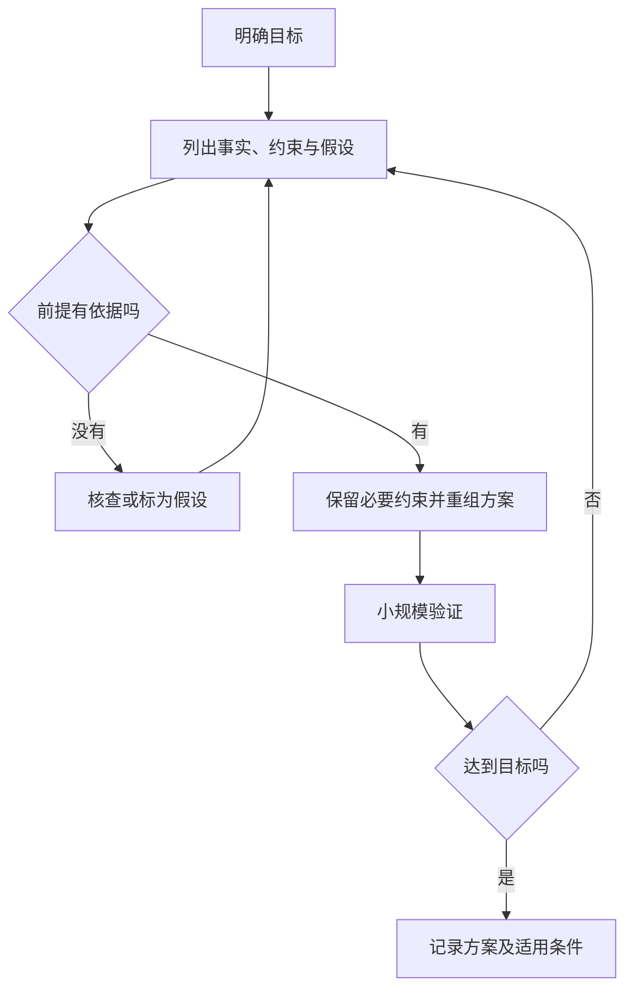

# 第一性原理

> 重新检查前提，从可信的基础事实与必要约束出发推导方案。

类型：推理取向。状态：哲学背景已核验；下列业务流程是项目改编，不是亚里士多德的方法原文。核验日期：2026-11-17。

## 何时使用

- 适用：现有方案受惯例限制，需要重新设计成本、结构或流程。
- 不适用：已有成熟方法可直接解决的小问题；缺少领域知识时，不应自行宣布找到了不可动摇的事实。
- 输入：目标、可核实事实、现实约束、现有方案依赖的假设。

## 步骤与逻辑

1. 明确要实现的结果，不先绑定某个方案。
2. 将陈述分成事实、约束、假设；记录事实的依据。
3. 逐项质疑假设：没有这个惯例，目标还能怎样实现？
4. 基于保留的约束重组方案；检查遗漏和副作用。
5. 用小实验检验；新证据推翻前提时回到第二步。

文字路径：明确目标 → 核查前提 → 重组方案 → 验证；前提有误时返回检查。

## 虚构示例

目标是让读者迅速理解回答。必要条件是结论正确、关键限制完整；“每次写十段”“每次画图”只是未经验证的表达惯例。替代方案是短结论加必要依据，将详细材料放到文档中，再用理解任务比较效果。

输出：事实与假设表、替代方案、验证计划。

## 误用与衔接

不能把个人直觉叫作基础事实，也不能因追求原创而丢弃可靠经验。基础事实只能支持限定范围内的推断，不自动保证方案可行。

先用 [5W1H](5W1H.md) 澄清目标；需要比较方案时转入[决策矩阵](../03-决策与取舍/决策矩阵.md)。已有可检验方案后停止无限拆解，用 [PDCA](../04-执行与复盘/PDCA.md) 验证。

## 来源

[Stanford Encyclopedia of Philosophy：Aristotle，§4.2–4.3](https://plato.stanford.edu/entries/aristotle/)，已查阅网页相关正文。这里区分哲学上的第一原理与现代业务中“质疑假设”的实践用法；业务模板不主张普遍证明能力。
