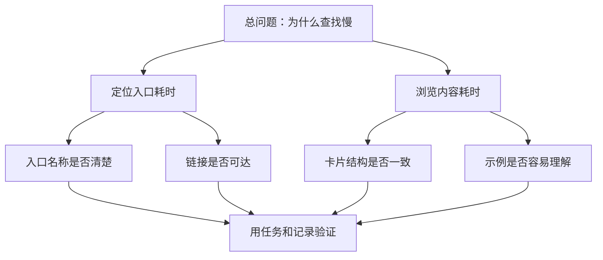

# 问题树与 MECE

> 问题树用于拆解问题；MECE 用于检查同一层分类是否重叠、是否遗漏。

类型：拆解工具与分类原则。MECE 指 Mutually Exclusive、Collectively Exhaustive。状态：术语已核验；拆解流程为项目改编。核验日期：2026-11-17。

## 何时使用

适合范围大、调查方向不清的问题。输入是明确的总问题、范围、拆分维度与已知事实。对于存在反馈、耦合的系统，不应为了形式强行假设各原因独立。

## 步骤与逻辑

1. 写清总问题及边界。
2. 每一层选一个拆分维度，如时间阶段、对象类别或公式因素。
3. 检查分支是否重叠、是否覆盖范围；记录跨分支依赖。
4. 将末端分支改成可验证问题，指定证据需求。
5. 根据证据保留、合并或修订分支。

文字路径：总问题 → 按统一维度拆分 → 可验证子问题 → 查证。示意分支是调查框架，不是已证明的原因。

## 虚构示例

按耗时阶段拆分“查找慢”，先测从首页到目标卡片的定位时间，再测阅读卡片的理解时间。不能一层同时混列“名称、员工、周末、内容多”，因为维度不同且容易重复。

输出：问题树、各分支证据需求、已知交互关系。

## 误用与衔接

分类互斥不代表因果独立；现实中可能暂时无法穷尽，应保留“其他/待发现”并继续调查。已经拆到可采证的粒度就停止，具体原因用 [5 Whys](../02-分析与判断/5Whys.md) 调查；多因素相互作用可画关系图。

## 来源

[McKinsey 对 Barbara Minto 的访谈](https://www.mckinsey.com/alumni/news-and-events/global-news/alumni-news/barbara-minto-mece-i-invented-it-so-i-get-to-say-how-to-pronounce-it)，已查阅网页正文，确认 MECE 术语含义；不据此主张问题树模板为原作者标准流程。
