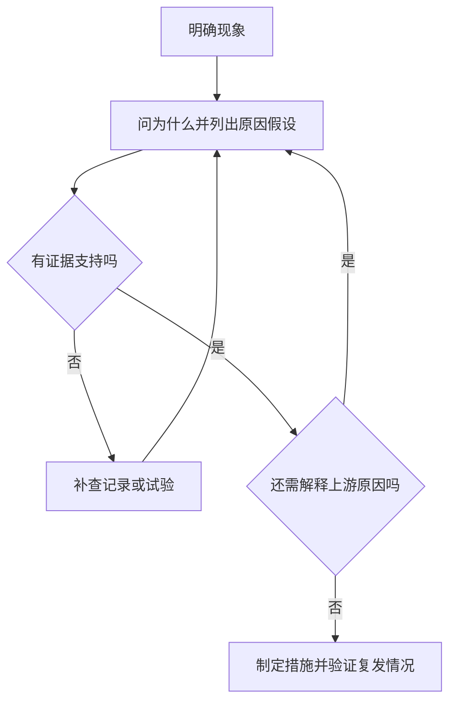

# 5 Whys

> 沿现象逐层追问为什么，形成需要证据检验的原因链。

类型：原因探索工具。状态：已核验 ASQ 正文；证据检查流程为项目补充。核验日期：2026-11-17。

## 何时使用

适合范围明确、重复发生的问题；多因素故障不能只保留一条原因链。输入包括现象、时间范围、日志或事件记录。

## 步骤与逻辑

1. 写清实际发生的现象，而非带责备的判断。
2. 问为什么，记录一个或多个原因假设。
3. 为每个回答寻找记录、观察或试验支持；反证也要记录。
4. 对仍需解释的原因继续追问，可少于或多于五次。
5. 找到可采取措施的原因后，验证措施能否减少复发。

文字路径：现象 → 原因假设 → 查证 → 必要时继续追问 → 验证措施。

## 虚构示例

回答遗漏期限 → 需求提取记录没有期限 → 模板缺少约束检查。只有实际输入、提取记录、模板都支持这条链时，才把它作为整改依据；也要检查是否存在模型忽略已记录信息的另一分支。

输出：原因链、支持与反对证据、缺口、措施和验证结果。

## 误用与衔接

不要凑五次、把“人员不认真”当终点，或把一条顺畅故事当成根因证明。先用[鱼骨图](鱼骨图.md) 展开多分支；已有足够支持的可干预原因时停止追问，转入 [PDCA](../04-执行与复盘/PDCA.md)。

## 来源

[ASQ Five Whys and Five Hows](https://asq.org/quality-resources/five-whys)，已查阅正文；该页明确追问次数可少于或多于五次。
