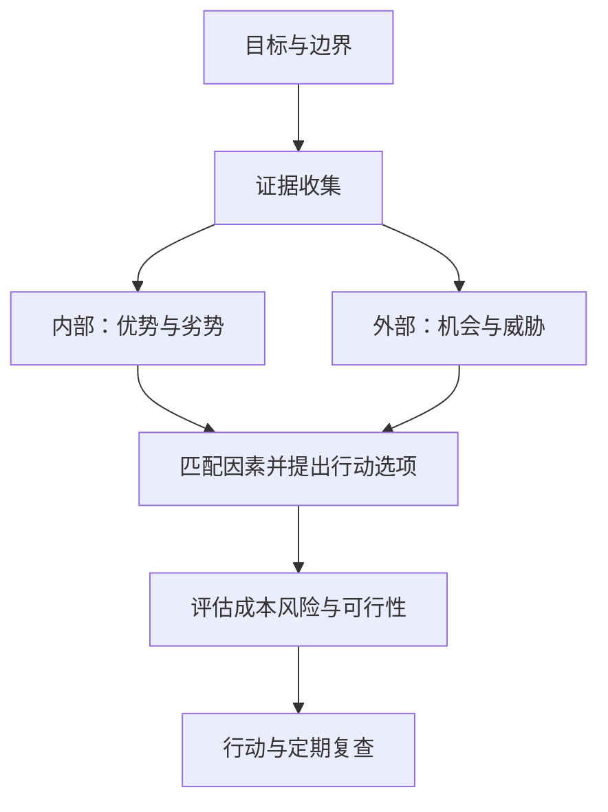

# SWOT：把处境分析转化为行动选项

一句话：围绕目标，整理内部优势与劣势、外部机会与威胁，再据此提出战略选项。

类型：处境整理与战略讨论框架。已核对 CIPD 正文；步骤和案例是项目简化改编，不主张有统一的标准打分公式。

## 适用边界

- 适用：准备开展项目或制定方向，需要系统整理内外部因素。
- 不适用：无法直接证明根因、预测未来或替代方案成本评估。
- 输入：明确目标、组织或项目边界、时间范围、实际证据。

## 四格关系

| 因素来源 | 对目标有利 | 对目标不利 |
|---|---|---|
| 内部：自身资源与能力 | Strengths 优势 | Weaknesses 劣势 |
| 外部：环境与条件 | Opportunities 机会 | Threats 威胁 |

“内部/外部”取决于分析边界；优势应说明相对于什么目标或参照，而不是罗列赞美词。

## 操作与逻辑

1. 明确目标、参照对象和时间范围。
2. 收集内外部证据，把事实、判断和待核验假设分开。
3. 分类到四格；去掉含糊、重复和无关事项。
4. 检查重要因素的相互关系，形成可行动的选项。
5. 比较成本、风险和约束，确定优先项及复查时间。

文字路径：目标 → 证据 → 内外部四格 → 行动选项 → 评估 → 执行复查。四格是整理材料的起点，分析发生在因素联系与取舍中。

## 虚构示例

目标是让团队使用模型库：内部优势是已有实践案例，劣势是维护时间有限；外部机会是培训需求增加，威胁是同类资料多且更新快。候选行动是用高频案例做短培训，而不是先扩充到几百张卡。该选项仍需试用和反馈验证。

输出：附证据的四格表、少量行动选项、优先级与复查安排。

误用：把内部缺人写成外部威胁；把机会等同于自己的行动计划；填完表就算战略；用主观评分伪造客观排名。

衔接：[决策矩阵](../03-决策与取舍/决策矩阵.md)比较选项；[事前复盘](../03-决策与取舍/逆向思考与事前复盘.md)检查失败路径。选项可执行后停止继续堆积因素。

来源：[CIPD：SWOT analysis](https://www.cipd.org/en/knowledge/factsheets/swot-analysis-factsheet/)，已查阅正文的框架、流程和局限，核对日期 2026-11-17。本文不采用有争议的单一发明者归属。
