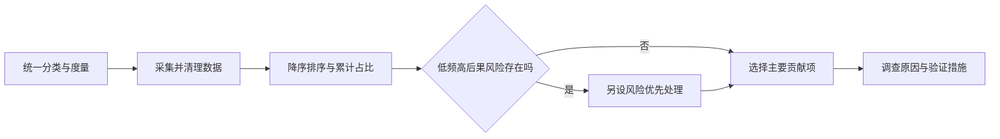

# 帕累托分析

> 将可比较的问题按频次、成本或影响排序，帮助选择优先项。

类型：数据排序工具。状态：已核验 ASQ 正文；示例为项目改编。核验日期：2026-11-17。

## 何时使用

输入须有同一期间、同一口径的分类数据。适合从许多问题中找重点；不能忽略低频但后果严重的风险。没有数据时先采集，不能先假设一定符合 80/20。

## 步骤与逻辑

1. 规定类别、期间与度量，如错误次数或损失金额。
2. 检查重复计数；多标签数据需声明分母与归类规则。
3. 汇总并降序排列；可计算累计占比。
4. 检查严重性、处理成本和数据偏差，确定优先措施。
5. 深入调查重点类别，再验证改进。

文字路径：统一口径 → 排序 → 结合严重性选重点 → 调查与改进。流程图说明方法，不代替实际的帕累托柱线图。

## 虚构示例

| 类别 | 次数 | 占比 | 累计占比 |
|---|---:|---:|---:|
| 遗漏需求 | 10 | 50% | 50% |
| 事实错误 | 6 | 30% | 80% |
| 格式问题 | 4 | 20% | 100% |

20 次记录中前两类占 80%，并非“20% 的类别导致 80% 的问题”；事实错误可能后果更严重，不能单凭频次数决定优先级。

输出：排序表、累计占比与优先事项及理由。

## 误用与衔接

不要强求 80/20、混加次数与金额，或把类别贡献当作已证明的根因。重点类别确定后转入 [5 Whys](5Whys.md)；措施试验用 [PDCA](../04-执行与复盘/PDCA.md)。

## 来源

[ASQ Pareto Chart](https://asq.org/quality-resources/pareto)，已查阅正文。ASQ 将累计百分比作为可选步骤；本卡不把 80/20 当作普遍定律。
