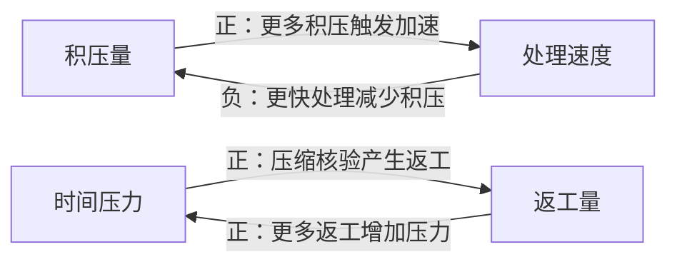

# 系统思考与反馈回路

一句话：观察变量怎样互相影响，以及反馈和延迟如何改变系统随时间的行为。

类型：系统分析视角与因果回路建模工具。术语已核验；本卡提供简化入门方法，不等于完整的系统动力学建模。

## 适用与边界

适用：局部优化带来反作用、问题反复出现、跨部门影响与时间延迟明显。不适用：静态任务清单无需强行画回路；仅有相关性时不能声称因果已经成立。

输入：问题的时间变化、系统边界、可增减的变量、连接依据和延迟信息。

## 步骤与逻辑

1. 明确关心的行为、时间范围与边界，先画观察到的时间变化。
2. 用“积压量”“处理速度”这样的变量名称，避免把行动口号当变量。
3. 逐条提出因果假设，标注正号或负号：其他条件相同，原因增加使结果相对原本增加为正，减少为负。
4. 找闭环：负连接数为偶数的简单闭环是强化回路 R，为奇数的是平衡回路 B；符号不表示好坏。
5. 标出重要延迟，收集证据和反例。若要定量预测，继续建立存量、流量、方程和校准模型。

文字路径：积压量→处理速度→积压量构成平衡回路 B；时间压力→返工量→时间压力构成强化回路 R。以上连接是虚构场景中的待核验假设，实际关系可能存在延迟或容量限制。

## 虚构示例

团队为清积压加快处理，但省略核验使返工增多。只看当天交付量会误判改进成功，应同时观察返工、积压与处理能力的时间变化。图帮助提出“短期加速是否损害后续能力”的问题，不能独立证明它发生了。

输出：边界说明、带极性和延迟的回路图、连接证据表、待验证干预。

误用：把所有箭头画成正号；把 R 当好、B 当坏；用回路图直接预测数值；漏掉库存积累或关键外部输入。

关联：[鱼骨图](鱼骨图.md)偏重展开可能原因，回路图关注相互作用；用[假设驱动实验](../04-执行与复盘/假设驱动实验.md)验证可干预连接。已有可检验解释和干预时停止无限扩图。

来源：[David N. Ford，A System Dynamics Glossary，2019](https://web.mit.edu/blossoms/sites/default/files/video/download/Ford-2019-System_Dynamics_Review.pdf)，2026-11-17 已访问论文 PDF 文本；用于核验因果连接、极性、延迟及回路术语。
