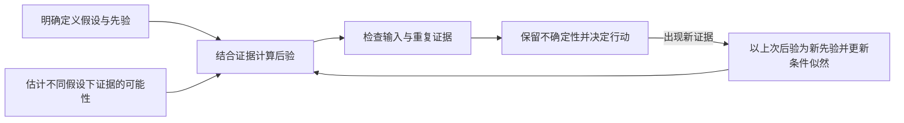

# 贝叶斯更新

一句话：根据新证据在不同假设下出现的可能性，更新对假设的概率判断。

类型：概率推断方法。基础公式已核验；业务流程与示例为项目改编。

## 适用与边界

适用：故障诊断、逐步积累证据、比较竞争解释。不适用：没有可辩护的先验和似然时，不应为了显得科学而编造精确概率；确定性的逻辑证明也不需要此法。

输入：互斥且覆盖所讨论可能性的假设、先验概率、证据及其条件概率。二元情况还需要“假设不成立时出现该证据”的概率。

二元公式：`P(H|E) = P(E|H)P(H) / [P(E|H)P(H) + P(E|非H)P(非H)]`，要求分母大于零。H 是假设，E 是证据。

## 步骤与逻辑

1. 定义假设 H 和证据 E，明确概率适用的总体与条件。
2. 记录先验 P(H)，以及 P(E|H)、P(E|非H) 的来源和不确定性。
3. 计算后验：P(H|E) = P(E|H)P(H) / [P(E|H)P(H) + P(E|非H)P(非H)]，要求分母大于零。
4. 检查结果对输入的敏感性；后续证据需使用条件概率，不能把相关证据当独立证据重复相乘。
5. 根据行动成本和风险作决定，概率更新本身不直接给出行动。

文字路径：先验和似然共同决定后验；后验与行动约束共同支持决策。新证据到来时再次更新，而不是重新忽略历史。

## 虚构示例

假设 10% 的构建失败来自依赖问题；若确为依赖问题，特定日志出现率为 80%；其他原因时为 20%。看到该日志后，依赖问题概率为 0.8×0.1 / (0.8×0.1+0.2×0.9) ≈ 30.8%。它比原来的 10% 更值得检查，但并非“80% 确定”。这些数字是演示假设，不是实际故障统计。

输出：先验、似然、后验及来源表，另附行动理由。

误用：把 P(E|H) 当 P(H|E)；忽略基准率；重复计算同一来源证据；把主观输入隐藏成客观结果。

关联：用[敏感性分析](../03-决策与取舍/敏感性分析.md)检查先验变化，用[期望值与决策树](../03-决策与取舍/期望值与决策树.md)比较行动。达到预先约定的决策条件或新增信息价值不足时停止收集。

来源：[OpenStax《Principles of Data Science》3.4](https://openstax.org/books/principles-data-science/pages/3-4-probability-theory)，2026-11-17 已访问网页正文；用于核验条件概率和贝叶斯定理，不为示例输入背书。
