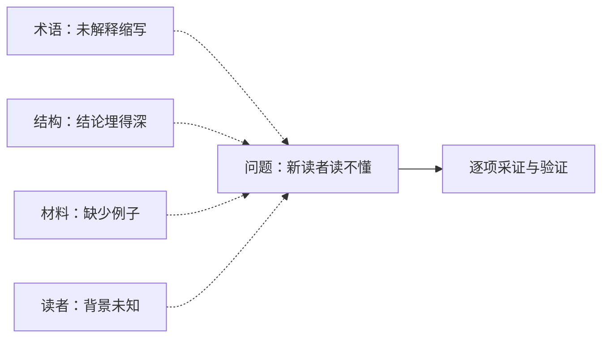

# 鱼骨图

> 将一个问题的可能原因按类别展开，帮助组织调查。

类型：原因假设整理工具，又称因果图、石川图。状态：已核验 ASQ 正文；示例与证据表为项目改编。核验日期：2026-11-17。

## 何时使用

适合多来源、多因素的问题；已知简单原因时可直接处理。输入是可观察的问题、范围和相关人员的知识与记录。

## 步骤与逻辑

1. 写清鱼头：要解释的具体结果。
2. 按实际场景设主骨类别，不必固定使用制造业 6M。
3. 列出可能原因及子原因，允许跨类别关联。
4. 为候选原因安排采证，区分猜测、支持、排除。
5. 对优先原因实施验证并更新图。

文字路径：各类原因假设汇聚到同一问题 → 逐项查证。虚线只表示待检验的可能解释；这是鱼骨关系的 Mermaid 简化示意，不是严格鱼骨形状。

## 虚构示例

读者在 PDCA 卡片上停留很久，不一定说明术语太难：也可能是图太复杂、读者认真学习或页面未关闭。通过观察任务、访谈与内容对照区分解释。

输出：原因分类图、证据状态与验证优先级。

## 误用与衔接

图不证明因果，分类齐全不代表原因已穷尽。先展开，再用 [5 Whys](5Whys.md) 深入有依据的分支；形成可检验的主要假设后停止头脑风暴，转入验证。

## 来源

[ASQ Fishbone](https://asq.org/quality-resources/fishbone)，已查阅定义与操作正文；ASQ 允许按语境调整类别。
