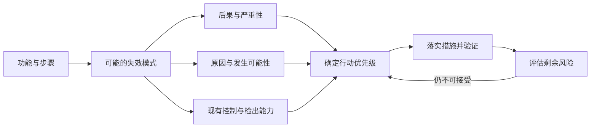

# FMEA：失效模式与影响分析

一句话：按系统功能或过程步骤，识别可能怎样失败、会造成什么后果，并安排降低风险的措施。

类型：主动风险分析工具。基础定义已核对 ASQ 正文。这里是学习用简化模板，不替代行业规定的正式 FMEA 方法或评分表。

## 适用边界

- 适用：设计、改造或评估流程时，希望提前预防故障。
- 不适用：不能仅靠清单发现所有未知风险；复杂的故障组合与交互需要补充其他分析。
- 输入：功能、流程边界、失败记录、现有控制、跨角色知识。

## 怎么做

1. 明确分析对象、功能、边界与团队。
2. 对每项功能列出失效模式，并区分失效后果与潜在原因。
3. 记录现有预防和检测措施，评估严重性、发生可能性及难以检出的程度。
4. 按适用制度确定优先级，优先处理严重后果，记录评分依据与不确定性。
5. 为措施指定负责人、期限与验证方式；实施后重新评估剩余风险。

文字路径：功能 → 失效 → 后果、原因、控制 → 优先行动 → 验证剩余风险。箭头表示分析依赖，并非证明故障一定发生。

## 虚构示例

| 功能 | 失效模式 | 后果 | 潜在原因 | 现有控制 | 候选措施 |
|---|---|---|---|---|---|
| 发布文档 | 草稿被当成核验版本发布 | 使用者依赖错误资料 | 状态字段缺失 | 人工检查 | 增加状态必填和发布复核 |

输出：失效登记表、措施、责任安排、验证结果和剩余风险；没有数据时写“待评估”，不编造评分。

## 常见误用

- 混淆“错误发布”这一失效与“状态字段缺失”这一潜在原因。
- 把一个风险分数当成真实损失概率。
- 部分传统方法用 RPN = 严重性 S × 发生度 O × 探测度 D；这些通常是等级分数，不是概率。相同乘积可能隐藏不同的高严重性风险，不能仅按乘积决定优先级。
- 不同制度的量表、阈值与行动规则不同，不能混用；D 的高低方向也必须写清。

衔接：[事前复盘](逆向思考与事前复盘.md)适合先广泛发现风险；FMEA 对功能逐项分析；[PDCA](../04-执行与复盘/PDCA.md)验证改进。风险被责任方接受或有明确后续行动时，结束本轮分析。

来源：[ASQ：FMEA](https://asq.org/quality-resources/fmea)，已查阅正文的定义、步骤与局限，核对日期 2026-11-17。本文不声称遵循任何特定行业认证标准。
