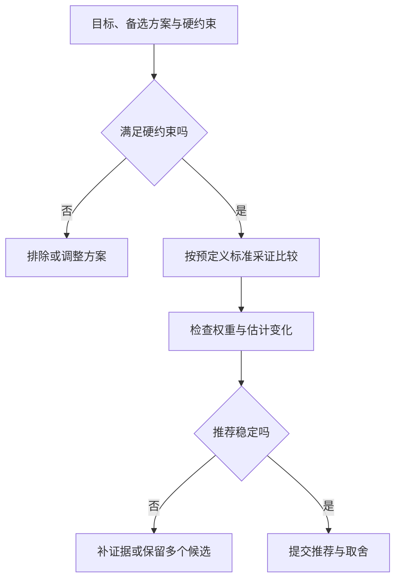

# 决策矩阵

> 按事先定义的标准比较方案，并检查推荐是否依赖脆弱假设。

类型：多标准决策工具。状态：已核验 NASA 决策分析正文；评分模板为项目简化。核验日期：2026-11-17。

## 何时使用

适合多个方案各有取舍的决策。输入是目标、硬约束、候选方案、评价标准与证据。信息严重不足时，应先采证，不能用精确分数掩盖不确定性。

## 步骤与逻辑

1. 先筛查硬约束；违反必需条件的方案不靠其他高分弥补。
2. 预先定义维度、尺度与必要权重；避免重复计算同一收益。
3. 用证据评分，记录估计区间和未知项。
4. 适合相加的尺度可计算加权总分；总分只是比较辅助。
5. 改变关键权重或假设，检查排名是否变化，并报告改变条件。

文字路径：硬约束筛选 → 采证比较 → 敏感性检查 → 有条件推荐。

## 虚构示例

选择文档平台：离线访问是硬约束；在合格方案中比较维护工时与检索体验。若 A 的优势只在某个主观权重下成立，应报告“取决于你更重视维护还是检索”，而不是宣布 A 客观最佳。

输出：标准和证据表、推荐、关键取舍、结论改变条件。

## 误用与衔接

不能选完再改权重；不同单位不能直接相加。对排名接近且不确定性大的方案，保留候选或做试验。用[事前复盘](逆向思考与事前复盘.md) 检查风险；推荐已足够支持决策时停止细化评分。

## 来源

[NASA Systems Engineering Handbook §6.8 Decision Analysis](https://www.nasa.gov/reference/6-8-decision-analysis/)，已查阅标准、强制条件、不确定性与比较方法相关正文。
