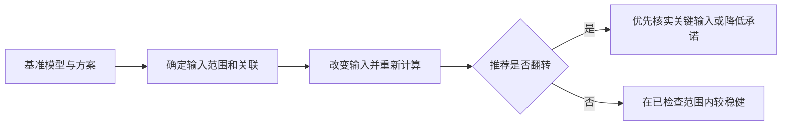

# 敏感性分析

一句话：改变模型输入或假设，检查结论变化以及哪些输入最值得核实。

类型：模型稳健性分析方法族。基础定义已核验；本卡是简单决策的入门流程，不代替完整全局敏感性分析。

## 适用与边界

适用：方案依赖估计、权重、成本、概率等不确定输入。不适用：没有明确输出和输入关系时，先定义模型；敏感性低也不能证明模型结构正确。

输入：计算或评分模型、基准值、合理变化范围、输入关联、决策阈值。

## 步骤与逻辑

1. 写出模型、关键输出和基准选择。
2. 为不确定输入设置有依据的范围，不只随意上下浮动 10%。
3. 单因素变化适合初步理解局部影响；存在非线性、交互或相关输入时，补充联合场景或合适的全局方法。
4. 记录输出如何变化，找出推荐翻转的阈值。
5. 优先核实会改变行动的输入；说明未覆盖的不确定性。

文字路径：在合理输入范围内反复计算，找结论改变的条件；稳健结论仅限检查过的模型和范围。

## 虚构示例

沿用试行成功净收益 100、失败净收益 -80 的假设，成功概率为 p，则期望净收益为 180p−80。与现状 0 相比，临界概率为 80/180≈44.4%。若可信范围为 30%—70%，推荐会翻转，应优先核实成功概率；若为 60%—70%，这一维度内较稳健，但仍需检查收益估计和最坏损失。

输出：输入范围、结果区间、翻转阈值、优先补证项。

误用：只改一个因素就宣称全面稳健；忽略输入相关性；故意选窄范围保住结论；将敏感性等同于因果强度。

关联：[决策矩阵](决策矩阵.md)、[期望值与决策树](期望值与决策树.md)提供被检查的模型。关键决策在合理范围内稳定或已确定需收集的信息后停止。

来源：[欧盟联合研究中心 JRC：Methods](https://joint-research-centre.ec.europa.eu/sensitivity-analysis-samo/methods_en)，2026-11-17 已访问官方网页正文，核验全局分析、输入范围与交互的重要性。
