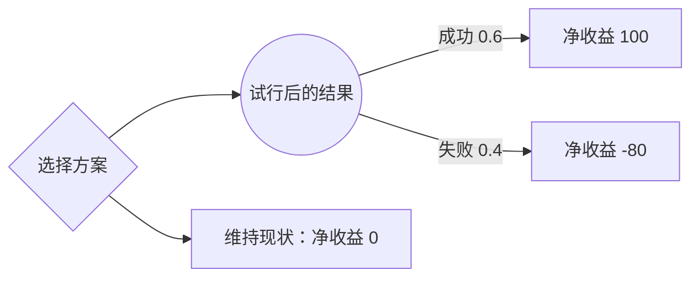

# 期望值与决策树

一句话：把可选择的行动与不确定结果展开，再按概率加权比较结果。

类型：定量决策工具。期望值公式已核验；决策树为项目简化表达。

## 适用与边界

适用：能列出主要结果，并有可辩护概率和结果价值的选择。不适用：未知概率不能假装精确；不可承受损失、硬约束或强风险偏好不能只靠最高期望金额决定。

输入：行动、各行动下互斥且覆盖全部情况的结果、条件概率、同口径的净收益或效用。

## 步骤与逻辑

1. 区分“能选择的行动”与“无法控制的随机结果”。
2. 每个随机节点的结果概率之和应为 1；多阶段用对应历史条件下的概率。
3. 将成本纳入每个终点的净结果，避免重复扣减。
4. 从末端向前计算：随机节点取加权均值，决策节点在约束下比较可选值。
5. 同时报告最坏结果与结论翻转条件；风险偏好重要时需要效用或其他风险约束。

文字路径：先选择试行或维持现状；试行后才发生不确定结果。图中的数字均为虚构，净收益已经扣除成本。

## 虚构示例

试行的期望净收益为 0.6×100 + 0.4×(-80) = 28，维持现状为 0。在这些假设与风险中性口径下，试行更高；但如果无法承受损失 80，该方案仍可能不可行。期望值 28 不意味着这一次会获得 28。

输出：决策树、输入来源、期望值、最坏结果与推荐条件。

误用：把概率当确定结果；分支重叠；用无条件概率替代条件概率；忽略尾部风险；把期望金额当普遍效用。

关联：[贝叶斯更新](../02-分析与判断/贝叶斯更新.md)调整结果概率，[敏感性分析](敏感性分析.md)检查推荐稳定性。估计无法支撑行动时转向收集信息或小规模试验。

来源：[OpenStax《Introductory Statistics 2e》4.2](https://openstax.org/books/introductory-statistics-2e/pages/4-2-mean-or-expected-value-and-standard-deviation)，2026-11-17 已访问网页正文，核验离散期望值公式；[NASA Decision Analysis](https://www.nasa.gov/reference/6-8-decision-analysis/)，已访问网页正文，作为目标、方案与约束分析参考。
