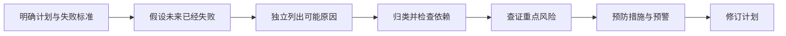

# 逆向思考与事前复盘

> 逆向思考从不希望发生的结果反查条件；事前复盘是其中一种团队风险讨论方法。

类型：启发式与风险识别方法。状态：事前复盘已核验提出者网站；下列风险行动模板为项目改编。核验日期：2026-11-17。

## 何时使用

已有具体计划、仍能调整时使用。输入是计划、成功与失败标准、关键依赖。不适合用来估计真实失败概率；想象力不能替代风险数据。

## 步骤与逻辑

1. 对齐同一个计划，定义何谓失败。
2. 假设计划在未来已经失败，参与者先独立写可能原因。
3. 汇总并检查关键依赖、遗漏和相互作用。
4. 按后果与可干预程度挑重点，补实际证据。
5. 指定预防动作、预警信号、负责人和复查点。

文字路径：假设失败 → 列原因 → 查证 → 预防与预警 → 修订计划。

## 虚构示例

模型库半年后无人使用：可能是名称难找、卡片太长、来源不可信。先安排检索任务观察真实障碍；针对证实的问题设置入口索引、短摘要与来源状态，而非无差别增加功能。

输出：风险、证据状态、预警信号、应对动作和责任人清单。

## 误用与衔接

逆向思考不限于失败讨论；事前复盘也不等于行动后的 AAR。不要把所有担忧都标为最高风险，或假装已推算概率。重点风险已有应对后停止发散，结合[决策矩阵](决策矩阵.md) 或 [PDCA](../04-执行与复盘/PDCA.md) 推进。

## 来源

[Gary Klein：Premortem](https://www.gary-klein.com/premortem)，已查阅网页正文，确认团队先假设计划失败再识别威胁的基本方法；不据其效果目标宣称本项目已提高成功率。
