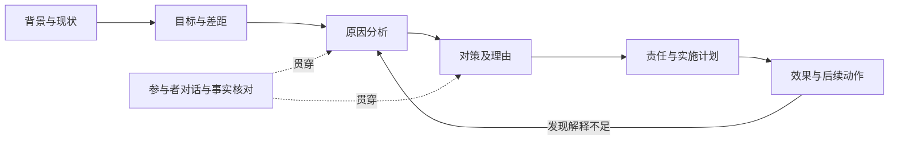

# A3 问题解决

一句话：用简洁的共同载体串联问题、事实、分析、对策和跟进，支持协作中的问题解决。

类型：精益管理实践与沟通载体。基础定义已核验；以下栏目为项目改编，没有唯一强制版式。

## 适用与边界

适用：跨角色改进，需要把事实、推理和行动放在同一张可讨论的页面。不适用：复杂证据不能为了塞进一页而删除；A3 不是只交一张表，也不要求所有数字文档恰好为纸张尺寸。

输入：业务背景、现状数据、目标差距、原因证据、参与者与可用资源。

## 步骤与逻辑

1. 写清背景、问题边界和现状，用数据或图说明差距。
2. 设定目标，分析原因并区分证据与假设。
3. 比较对策，每个对策应对应原因或已知缺口。
4. 通过对话校验理解，明确谁在何时做什么。
5. 跟踪结果与未解决问题，持续更新；详细材料链接到附录。

文字路径：现状和目标界定问题，原因支持对策，对策落实为行动并接受效果检查；参与者对话贯穿分析和选择。

## 虚构示例

问题：模型卡片难查找；现状：6 次测试中 4 次需要人工提示；目标：同类探索测试中减少求助。原因假设为按名称而非问题组织。对策为新增问题索引，并约定测试、维护与复查动作。小样本结果只能作为探索线索，详细查找记录放附录。

输出：一页主线说明、证据链接、责任计划、跟进记录。

误用：先选方案再补原因；为了版面删限制；只填模板不对话；只报成功不记录未解决问题。

关联：[问题树与 MECE](../01-理解与拆解/问题树与MECE.md)帮助拆解，[PDCA](PDCA.md)管理迭代；A3 侧重把思考与沟通连起来。问题有证据支持的处理结果与后续责任时完成本轮。

来源：[Lean Enterprise Institute：A3 Report](https://www.lean.org/lexicon-terms/a3-report/)，2026-11-17 已访问机构网页正文，核验 A3 作为报告及管理对话过程的含义。
