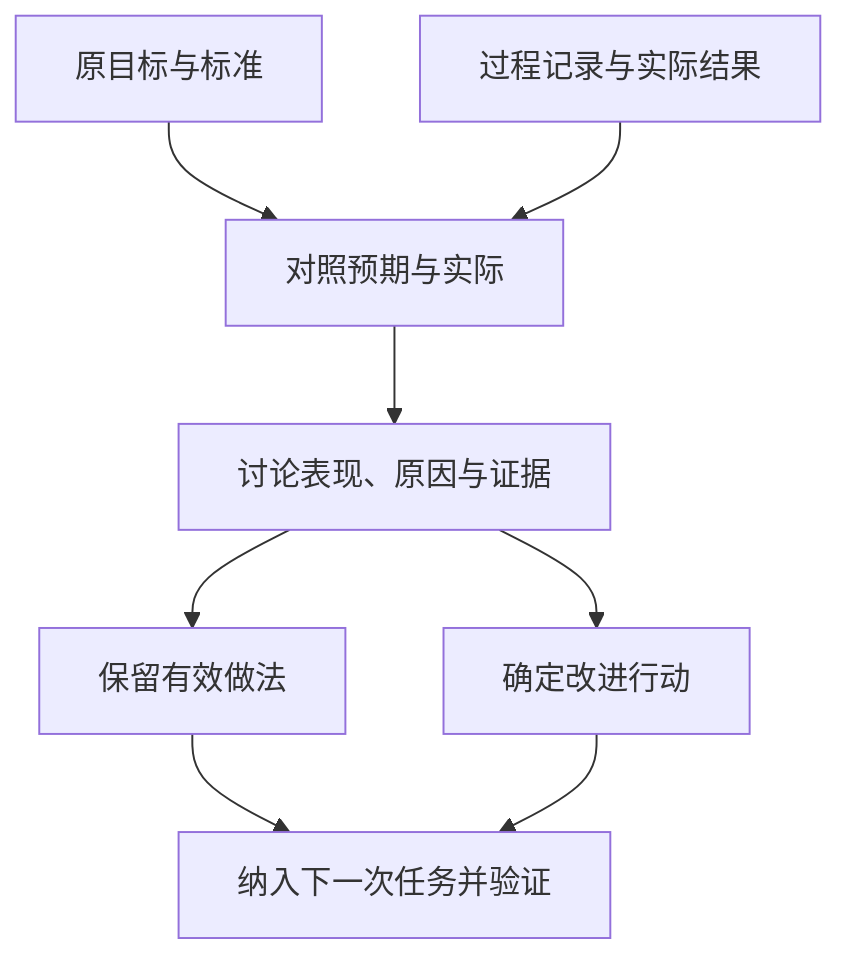

# AAR：行动后复盘

> 对照预期与实际表现，通过事实讨论形成可执行的改进。

类型：团队学习与复盘方法。状态：已查阅美国陆军官方手册相关正文；下列业务行动表为项目改编。核验日期：2026-11-17。

## 何时使用

适合训练、项目或一轮实验中及结束后的学习。输入是原计划、验收标准、实际过程、结果和参与者观察。缺少事实时先补记录，不以记忆分配责任。

## 步骤与逻辑

1. 预期发生什么？对齐原目标与标准。
2. 实际发生什么？整理可核验记录，区分观察与解释。
3. 哪些做得好、为什么？哪些可改进、如何改？检查不同观点和证据。
4. 形成保留项与改进行动，指定跟进和验证方式。

文字路径：预期与实际汇合 → 分析表现与原因 → 保留和改进 → 下一次验证。

## 虚构示例

原计划完成 30 张模型卡，实际完成 10 张。来源核验比预估耗时；先用记录确认工时和卡片质量，再决定先交付高频模型、其他保留候选。不能仅凭数量认定效率低，也不能只讨论不足而忽略核验质量提升。

输出：事实差异、可保留经验、少量改进行动及负责人、复查点。

## 误用与衔接

AAR 不等于追责会或结果汇报；好结果也可能包含偶然，坏结果也可能有值得保留的过程。行动和跟进已明确后结束会议，将动作纳入 [PDCA](PDCA.md)。事前风险识别参见[事前复盘](../03-决策与取舍/逆向思考与事前复盘.md)。

## 来源

[美国陆军 CALL：People First Task Force Handbook，§2-2e](https://api.army.mil/e2/c/downloads/2023/01/31/692c03bc/22-06-672-people-first-task-force-handbook.pdf)，已查阅相关正文中四项复盘问题。另有 [FM 7-0 Appendix K](https://www.first.army.mil/Portals/102/FM%207-0%20Appendix%20K.pdf) 官方入口，本轮直接访问 403，未据此声称读过全文。
