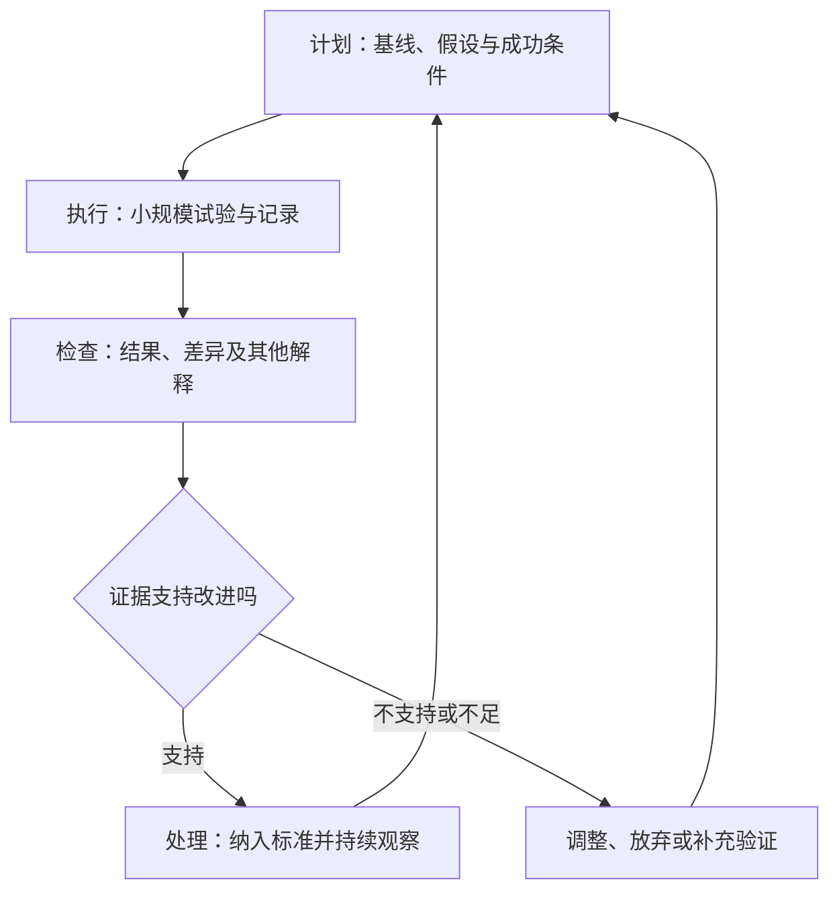

# PDCA

> 用 Plan、Do、Check、Act 循环检验改进，并据结果保留或调整做法。

类型：持续改进循环。状态：已核验 ASQ 正文；评测试验设计为项目改编。核验日期：2026-11-17。

## 何时使用

适合有可观察结果、能先小规模改变的改进任务。输入是问题、基线、改进假设、资源与约束。紧急事件先控制影响，不能为走流程延误必要行动。

## 步骤与逻辑

| 阶段 | 操作 | 产物 |
|---|---|---|
| Plan 计划 | 定义问题、基线、假设与成功条件 | 小试计划与指标 |
| Do 执行 | 小规模实施，记录过程和异常 | 原始记录 |
| Check 检查 | 对照预期分析变化与其他解释 | 学习结论和局限 |
| Act 处理 | 有效则适当推广，无效则调整或放弃 | 标准更新或下一轮计划 |

文字路径：计划 → 执行 → 检查 → 根据证据处理 → 下一轮。

## 虚构示例

固定 20 个任务，比较旧、新提示词的重复内容与需求遗漏；同一模型设置下保存原始输出，隐藏版本人工评审。只有简洁改善且准确、完整未退步时才保留。此处是试验设计，不是已执行结果。

输出：基线、试验记录、结果、采用或放弃理由、下一步动作。

## 误用与衔接

检查不是只确认“做完”；Act 不是继续照做。不要事后改成功条件，或用一次好结果证明普遍有效。PDCA 与 PDSA 有共同历史但不应抹平用词和实践差异；本卡使用 PDCA。

原因不清时先用 [5 Whys](../02-分析与判断/5Whys.md)；一轮结束用 [AAR](AAR.md) 整理经验。达到本轮验收条件后交付，循环不等于永不结束。

## 来源

[ASQ PDCA Cycle](https://asq.org/quality-resources/pdca-cycle)，已查阅定义、适用场景与四阶段操作正文。
