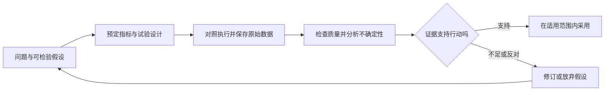

# 假设驱动实验

一句话：把想法写成可能被结果否定的预测，再设计能够区分解释的试验。

类型：实验设计工作方法。参考已核验的实验设计指南；本卡为项目简化流程，不是单一作者命名的模型。

## 适用与边界

适用：可以控制干预、观察结果，且试验成本可接受的改进。不适用：不能随机或控制时，不应把简单前后对比当作严格因果证明；不可逆的大规模行动应先考虑可行的低风险验证。

输入：问题、机制假设、干预、对照、观察单位、指标、资源和限制。

## 步骤与逻辑

1. 写成“若改变 X，则 Y 相对对照如何变化，因为 Z”的假设。
2. 事先确定主要指标、质量底线、样本或运行次数依据、停止规则与分析方式。
3. 选择与目标相匹配的设计；能随机则随机，必要时分组或配对以控制差异。
4. 执行并保留原始数据、异常和偏离计划的情况。
5. 检查测量与设计假设，报告效应、不确定性和替代解释；决定保留、修订或放弃。

文字路径：先写假设和判断标准，再执行和分析；证据不足不等于证明无效，证据支持也只在试验条件内成立。

## 虚构示例

假设“先列用户约束能减少遗漏且不增加事实错误”。对固定案例比较两版提示词，控制模型设置，随机评审顺序，盲评完整性与正确性，重复运行。20 个案例可作为初步探索，但不能仅因用了 20 个就宣称统计结论充分；样本量需结合预期效应、波动和判断要求设计。

输出：预先写明的试验计划、原始记录、结果与采用条件。

误用：事后挑指标；看到好结果就提前停止；把所有变量一起改；只有平均值没有波动；把未显著当作完全相同。

关联：[PDCA](PDCA.md)管理改进循环，本卡细化其中的验证；[贝叶斯更新](../02-分析与判断/贝叶斯更新.md)是可选推断方式，不能与频率学派检验规则随意混用。按预定规则完成后决定下一轮。

来源：[NIST/SEMATECH：Steps of DOE](https://www.itl.nist.gov/div898/handbook/pri/section1/pri14.htm)与[实验设计选择](https://www.itl.nist.gov/div898/handbook/pri/section3/pri33.htm)，2026-11-17 已访问官方网页正文。
