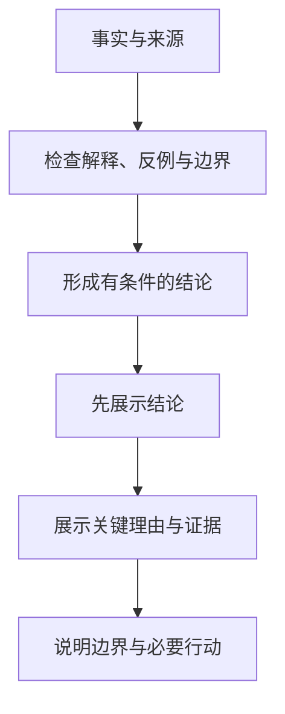

# 结论与支撑

> 先回答读者问题，再用理由和证据支撑，并保留必要边界。

类型：项目表达框架。状态：参考网页写作研究，模板为项目综合；不是某个商业框架的完整复刻。核验日期：2026-11-17。

## 何时使用

适合决策简报、研究摘要、进度说明。输入是读者问题、已核验信息、反证与不确定性。故事、探索讨论或用户指定的表达顺序可以不同。

## 步骤与逻辑

1. 从已核验信息形成对核心问题的回答。
2. 选出必要理由，每条理由放入相关证据。
3. 检查反例、限制和改变结论的条件。
4. 输出时先呈现结论，随后给依据；复杂关系再配图表。
5. 删除重复和不影响理解的细节，保留来源入口。

文字路径：形成判断时从证据出发；对外表达时从结论开始。表达顺序不等于研究顺序。

## 虚构示例

“建议模型库按使用问题分类，因为使用者通常先知道自己的问题。历史流派保留为标签，方便深入研究。这个设计仍需通过查找任务验证。”结论、理由、辅助安排和未验证条件都保留，没有伪装为已证实效果。

输出：简短结论、关键理由、来源、边界及需要时的动作。

## 误用与衔接

不能先定立场再挑证据，也不能删掉影响判断的限制。不要每段重述同一个结论。内容已足以理解和行动时停止展开；比较取舍可先用[决策矩阵](../03-决策与取舍/决策矩阵.md)，表达形式参见[表达选择](../../规范/表达选择.md)。

## 来源

[NN/g：How Users Read on the Web](https://www.nngroup.com/articles/how-users-read-on-the-web/)，已查阅正文，参考结论先行、可扫读与客观表达建议。将网页研究迁移到 AI 回答是项目设计选择，不能直接推断相同效果数值。
