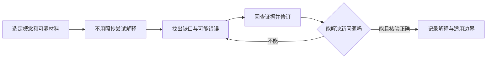

# 费曼式自我解释

一句话：用自己的话解释概念，借暴露的缺口回到可靠材料核对，再用新问题检查理解。

类型：学习与理解检查方法。本卡是通俗实践改编；不主张流行的“四步费曼法”已由费曼本人以固定形式提出。可核验研究依据是自我解释研究，两者不能直接等同。

## 适用与边界

适用：学完一个概念却不确定自己是否理解，准备给初学者解释。不适用：只有表达流畅不能证明知识正确；专业定义不能为了通俗而失真；操作技能还需要实际练习。

输入：一个边界明确的概念、可靠原材料、检验题或可观察任务。

## 步骤与逻辑

1. 明确要解释的内容及读者已知什么。
2. 暂时放下材料，用自己的话解释含义、原因、例子和适用条件。
3. 标出说不清、只会复述术语或推导断裂处。
4. 回查材料纠错，给类比补上不成立的边界。
5. 用不同于原例的新问题验证，必要时再次修订。

文字路径：解释暴露缺口，查证修订，再通过新任务检验；讲得顺不等于已经通过检验。

## 虚构示例

学习贝叶斯更新后，只说“新证据改变观点”还不够。尝试解释为什么某日志在故障中常见，并不代表看到日志就能确定故障；再独立计算一个新的基准率例题。若分不清两种条件概率，就回查公式与例子。

输出：短解释、一个例子、一个反例或边界、已纠正的缺口和检验结果。

误用：把“像教小孩一样讲”当充分条件；用不准确类比掩盖不懂；让 AI 写完解释就认定自己已学会；把某项研究结果泛化为任何科目都保证有效。

关联：[结论与支撑](结论与支撑.md)整理最终表达；本卡侧重学习时的理解检查。能够独立解答新问题且解释经材料核验后结束本轮，之后仍可间隔复习。

来源：[Chi 等，1994，Eliciting Self-Explanations Improves Understanding](https://onlinelibrary.wiley.com/doi/abs/10.1207/s15516709cog1803_3)，2026-11-17 已访问期刊页面摘要，未核验论文全文。研究提供特定学习任务中的自我解释证据，不直接证明本卡全部步骤或“费曼法”的历史归属。
