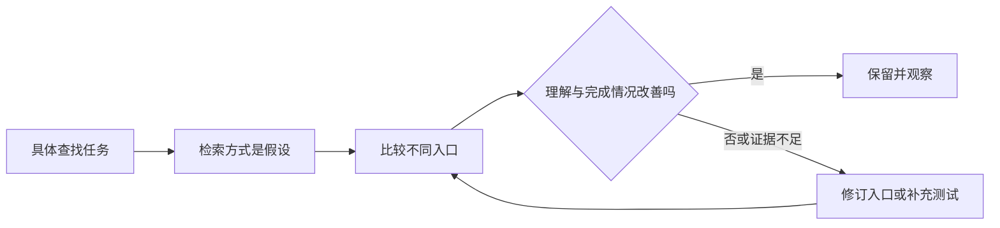

# 使用示例：让模型留下产物

以下案例均为虚构教学示例，不是已执行的实验，也不代表真实业务结果。

## 例一：模型库很多，却找不到要用的

| 步骤 | 选用模型 | 做什么 | 留下什么 |
|---|---|---|---|
| 定义问题 | 5W1H | 谁在什么任务中找不到模型？是名称陌生还是内容太长？ | 特定读者和查找任务 |
| 检查前提 | 第一性原理 | 模型必须按名字检索吗？用户首先知道的是问题还是名称？ | 事实、假设、替代入口 |
| 验证方案 | 假设驱动实验 | 比较名称列表与问题索引，控制任务差异 | 成功率、耗时、错误记录 |
| 处理结果 | PDCA | 达标则保留入口，否则分析失败任务 | 更新方案与复查安排 |

文字路径：具体任务 → 检查入口假设 → 比较 → 保留或修订。不能只因入口更短就判定改善。

## 例二：文档错误反复出现

先用同一期间、同一分类口径整理实际记录，再做帕累托排序；高严重性问题单独处理。鱼骨图提出可能原因，5 Whys 深入有证据支持的分支，实验验证改进措施，AAR 总结后续动作。

| 假设 | 需要什么证据 | 可以采取的验证 |
|---|---|---|
| 来源字段缺失导致核验遗漏 | 错误卡片是否集中在缺来源字段的条目 | 引入字段后比较遗漏情况，控制任务与评审差异 |
| 内容太长导致阅读遗漏 | 使用者在何处跳过必要信息 | 观察查找任务，比较分层组织方式 |

如果新字段存在但错误仍发生，就不能继续声称缺字段是唯一根因。

## 例三：应该继续扩充数量还是先核验来源

先确认约束与机会成本，再用决策矩阵比较“继续扩充”“优先核验”“按高频任务小批扩充并核验”。权重属于决策偏好，应事先写明。用敏感性分析检查维护时间、读者需求变化是否改变推荐。

| 候选方向 | 可能收益 | 代价与风险 | 验证方法 |
|---|---|---|---|
| 扩充数量 | 覆盖更多场景 | 维护和来源核验积压 | 检查新增模型的实际使用 |
| 优先核验 | 提高已有内容可靠性 | 新场景覆盖增长较慢 | 检查定义错误和来源缺口 |
| 小批扩充并核验 | 同时改善覆盖与可靠性 | 需要明确优先级 | 以高频任务试用并记录反馈 |

最后用“结论与支撑”说明推荐、证据和改变条件。没有真实权重与测试记录时，不给出伪精确的总分。
