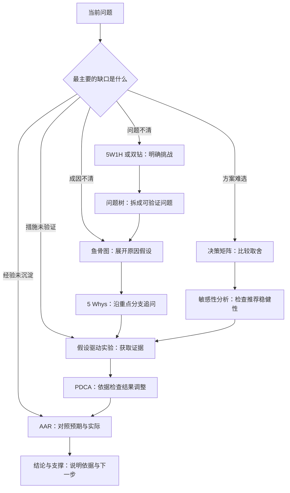

# 模型关系与组合

模型之间通常是互补关系，不是“高级模型替代低级模型”。图中的箭头表示可选的产物交接，不表示每次都要走完。

## 从问题到行动

文字路径：先识别当前缺口，直接进入对应模型；原因假设需要验证，方案比较需要检查不确定性，执行经验需要转化为下一轮行动。

## 容易混淆的关系

| 模型对 | 相同点 | 关键区别 | 何时衔接 |
|---|---|---|---|
| 第一性原理 / 5 Whys | 都会追问基础 | 前者检查推理前提并重建方案；后者分析特定现象的原因 | 发现“原因”只是惯例或假设时，检查前提 |
| 问题树 / 鱼骨图 | 都能展开分支 | 问题树可拆解目标、任务、问题；鱼骨图聚焦一个结果的可能原因 | 明确待解释的结果后再分析原因 |
| 鱼骨图 / 系统反馈图 | 都看关系 | 鱼骨图组织原因假设；反馈图关注循环、方向、延迟与动态行为 | 单向原因链不足以解释反复问题时 |
| 帕累托 / FMEA | 都可支持优先级 | 前者看实际记录的贡献；后者分析潜在失效及后果、发生、检出 | 高频问题之外，还要单独检查严重风险 |
| SWOT / 决策矩阵 | 都支持选择 | 前者整理内外处境并生成选项；后者按明确标准比较候选项 | 从处境转到可行方案后 |
| 贝叶斯更新 / 决策树 | 都处理不确定性 | 前者随证据更新信念；后者比较行动及可能后果 | 更新概率后重新评估行动 |
| PDCA / 假设驱动实验 | 都用反馈改进 | PDCA 是改进循环；实验是产生证据的一种方式 | 在一轮 PDCA 中设计实验验证具体假设 |
| AAR / 事前复盘 | 都关注预期与差异 | AAR 在行动后依据实际记录复盘；事前复盘在行动前想象失败路径 | 行动前防范，行动后校正假设 |
| A3 / PDCA | 都支持改进 | A3 用连贯叙事压缩问题、分析和跟进；PDCA 组织迭代过程 | 用 A3 记录一轮或多轮 PDCA |
| 费曼式自我解释 / 结论与支撑 | 都重视清楚表达 | 前者暴露自己的知识缺口；后者帮助读者定位已有结论与证据 | 先确认自己理解，再为读者组织材料 |

## 三条使用规则

1. 先选一个主要模型。只有它留下具体缺口，才加入下一种方法。
2. 每次交接带上产物：问题陈述、证据、方案表或实验记录；不能只说“已经做过分析”。
3. 达到当前任务的验收条件就停止；模型数量不是分析质量指标。

这是一张项目使用地图，不是统一的理论体系，也不证明某个组合一定优于其他方法。
