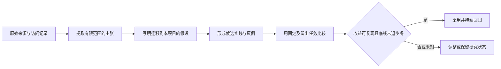

# 优秀实践专题研究 v0.3

检索与核对日期：2026-11-17。目标：为“准确、少废话、任务完成、结构清楚、图表易懂”提供可追溯的实践，而非收集更多口号。

本轮核对 15 项来源，包含重访材料。优先选择作者论文、官方文档、研究机构与原作者工程实践。检索覆盖 AI 工程、人机交互、技术写作、无障碍和项目改进；不是系统性综述，未穷尽文献，也未实施独立复现实验。

## 怎么理解证据

- 论文正文与实验细节、论文摘要、官方建议、团队经验不是同一证据等级。
- 已阅读相关正文不等于逐页精读整站或整篇论文；仅摘要的来源明确列出。
- 案例中的历史模型结果不直接代表当前模型。厂商经验也可能受产品、任务和成本条件影响。
- 下列“项目采用”均为候选实践。文档已整理，不代表本项目已实测有效。

## 来源与采用映射

| ID | 直接来源 | 类型与访问程度 | 与本项目有关的发现 | 去向 |
|---|---|---|---|---|
| R01 | [GOV.UK：Learning about users and their needs](https://www.gov.uk/service-manual/user-research/start-by-learning-user-needs) | 官方服务手册，相关正文 | 需求从用户要完成的事情和证据出发 | P01 |
| R02 | [Anthropic：Effective context engineering](https://www.anthropic.com/research/effective-context-engineering-for-ai-agents) | 厂商工程经验，正文；本轮重访前轮材料 | 材料应根据任务组织和检索 | P02 |
| R03 | [Liu 等：Lost in the Middle](https://aclanthology.org/2024.tacl-1.9/) | TACL 2024，摘要与元数据 | 所测任务对相关信息位置敏感 | P02、反例测试 |
| R04 | [Claude：Prompting best practices](https://platform.claude.com/docs/en/build-with-claude/prompt-engineering/claude-prompting-best-practices) | 官方产品建议，示例与上下文相关正文 | 用相关、多样的示例解释目标行为 | P03 |
| R05 | [Anthropic：Effective harnesses for long-running agents](https://www.anthropic.com/research/effective-harnesses-for-long-running-agents) | 厂商工程案例，相关正文 | 长任务需要接续状态和可检查阶段 | P04 |
| R06 | [Anthropic：Writing tools for agents](https://www.anthropic.com/research/writing-tools-for-agents) | 厂商工程实践，相关正文 | 职责与返回信息应服务真实任务 | P05 |
| R07 | [Huang 等：Large Language Models Cannot Self-Correct Reasoning Yet](https://arxiv.org/abs/2310.01798) | ICLR 2024，摘要与元数据 | 所测推理中的纯内部自纠有局限 | P06 |
| R08 | [Google：Clear sentences](https://developers.google.com/tech-writing/one/clear-sentences) | 官方写作课程，正文 | 具体主体、动词与描述有助于清楚表达 | P07 |
| R09 | [W3C WAI：Complex Images](https://www.w3.org/WAI/tutorials/images/complex/) | 官方无障碍教程，相关正文 | 复杂图需要承载关键信息的文字替代 | P08 |
| R10 | [Microsoft：Guidelines for Human-AI Interaction](https://www.microsoft.com/en-us/research/wp-content/uploads/2019/01/AI-Guidelines-poster_nogradient_final.pdf) | 研究团队官方指南，海报 PDF 文本；未精读 CHI 论文 | 明确能力与限制，支持纠正和恢复 | P09 |
| R11 | [Anthropic：Towards understanding sycophancy](https://www.anthropic.com/research/towards-understanding-sycophancy-in-language-models) | 作者研究页面摘要，未核验论文全文 | 用户偏好与真实性可能冲突 | P09 |
| R12 | [Zheng 等：Judging LLM-as-a-Judge](https://arxiv.org/abs/2306.05685) | NeurIPS 2023 Datasets and Benchmarks，摘要与元数据 | 自动评审存在顺序、冗长与自偏好等局限 | P10 |
| R13 | [Anthropic：Demystifying evals for AI agents](https://www.anthropic.com/research/demystifying-evals-for-ai-agents) | 2026 工程实践，相关正文 | 评测要对应结果、任务标准与回归需求 | P11 |
| R14 | [Google SRE：Postmortem Culture](https://sre.google/sre-book/postmortem-culture/) | 一线工程经验，相关正文 | 复盘应沉淀预防行动并跟进 | P12 |
| R15 | [Michael Nygard：Documenting Architecture Decisions](https://cognitect.com/blog/2011/11/15/documenting-architecture-decisions) | 原作者方法文章，正文 | 保留决策背景、状态和后果 | P12 |

## 从证据到规则需要走几步

文字路径：来源 → 有边界的主张 → 迁移假设 → 候选实践 → 实测 → 采用或调整。来源知名并不允许跳过最后的验证。

## 哪些建议不能照搬

| 常见建议 | 为什么需要条件 | 我们的处理 |
|---|---|---|
| 给更多背景 | 会引入无关信息；过短也会丢条件 | 按相关性选取，保留原文入口 |
| 每次都先规划 | 简单任务会增加负担 | 多步骤、依赖复杂时才显式规划 |
| 多给几个示例 | 可能机械模仿、污染评测 | 示例覆盖差异，留出题不参与调优 |
| 反复自查就能正确 | 没有新反馈时仍可能重复错误 | 优先引入原文、计算与实际状态 |
| 总是写更短 | 易删必要条件 | 准确和完整是底线，简洁优化其上 |
| 更多功能更优秀 | 某些产品示例鼓励扩展，并不符合所有需求 | 以当前交付目标控制范围 |
| 自动评审可以代替人 | 评审有偏差，尤其可能偏爱长答案 | 人工锚点与分歧校准，允许未知 |
| 有图就更好理解 | 图可能增加负担或画错逻辑 | 明确问题、条件与文字解释后再加图 |

## 当前最值得验证的三个假设

| 假设 | 最小比较 | 质量底线 | 能支持什么结论 |
|---|---|---|---|
| 任务契约减少遗漏 | 相同任务有无简短约束提取 | 事实错误不得增加 | 在受测任务上的完整性变化 |
| 按问题索引比名称列表更好找 | 相同查找任务、顺序控制 | 找到的模型必须适用 | 受测读者的查找表现 |
| 条件图加文字减少流程误解 | 相同规则的段落版与图文版 | 关键例外不能遗漏 | 受测任务的理解差异 |

以上未执行。样本量、统计方法和判定阈值应根据用途、成本与波动预先设计，不能把几个成功例子当普遍证明。

## 排除与后续研究

- 不以营销文章、转述榜单和社交帖子作为关键技术结论的唯一依据。
- 遇到标题不符、仅跳转或无法访问的页面，不计为有效内容来源。本轮 GOV.UK 写作旧入口只有跳转，因此采用可访问的服务手册与 Google 写作课程。
- 后续优先补读 R03、R07、R11、R12 的实验正文与后续研究，再讨论当前模型上的量化效果。
- 需要真实使用反馈来验证检索效率、误用率和维护成本；本轮新增文档数量不作为效果指标。
