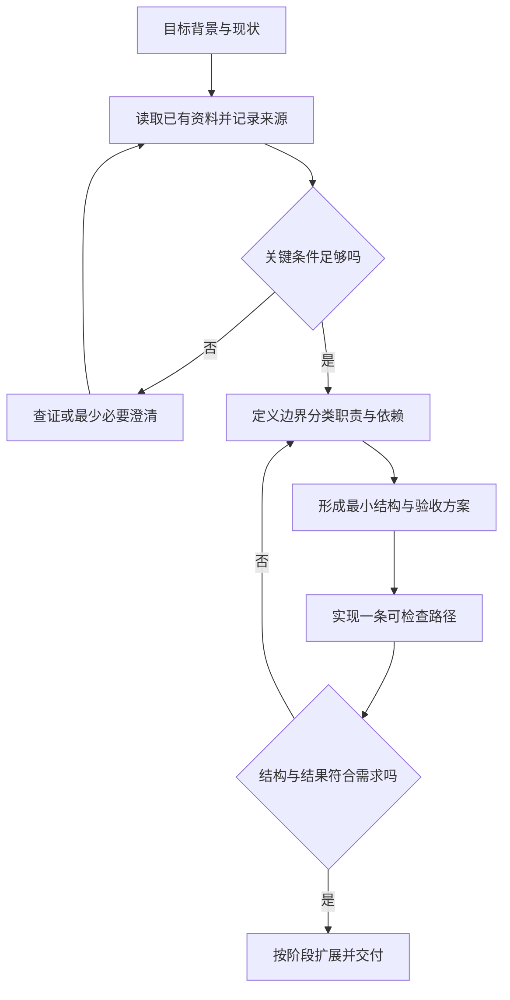

# 工作架构：先理解，再组织，再执行

本项目有两条主线：**回答质量**关注说得准、讲得清；**工作架构**关注如何理解、组织和完成任务。这里的架构包括目标、资料、分类、职责、依赖和验收，不只指代码分层或目录树。

## 用几个词记住

| 原则 | 落实为行为 |
|---|---|
| 背景先明 | 说明为什么做、为谁做、当前处境是什么 |
| 信息有据 | 先查已有资料，区分事实、假设和未知 |
| 边界清楚 | 明确本轮范围、约束与完成条件 |
| 分类有序 | 按用途和职责组织，命名与层级一致 |
| 依赖明确 | 知道谁提供输入、谁产生输出、哪里先后或并行 |
| 结构先行 | 复杂任务先形成最小可行结构，再批量生成 |
| 小步验证 | 先完成一条可检查路径，再扩展和调整 |

## 做到什么程度

| 任务 | 开工准备 | 不必增加的东西 |
|---|---|---|
| 简单问答或局部修改 | 从上下文确认目标和必要条件，直接执行 | 独立架构文档与完整目录规划 |
| 多文件或多步骤任务 | 简短背景、关键资料、范围、职责和依赖 | 为未知需求预建大量抽象层 |
| 新项目或结构重整 | 背景说明、信息清单、边界、结构图、阶段与验收 | 未确认需求的全部实现细节 |

背景说明只写影响当前行动的内容，避免每次长篇复述。优先检查现有组织方式并复用；调整结构时说明解决的具体问题。

## 开工前的六个问题

1. **为什么做？** 用户希望解决什么，读者或使用者是谁？
2. **已有何物？** 当前文件、系统、规则、数据和限制在哪里？
3. **还缺什么？** 哪些缺口影响正确性？可以继续查证，还是确需向用户澄清？
4. **如何划分？** 按什么维度分类？每个部分负责什么、边界在哪里？
5. **怎样连接？** 输入输出、依赖、状态流转及失败路径是什么？
6. **如何完成？** 本轮交付物、阶段顺序和可检查的验收条件是什么？

文字路径：理解背景 → 查资料 → 补关键缺口 → 定边界与关系 → 最小结构 → 小步验证 → 扩展。资料收集以足以支持下一步判断为止；执行中出现新证据，可以修订架构。

## 架构交付物应该回答什么

目录树说明内容放哪里；职责表说明为什么这样划分；流程或依赖图说明部分怎样协作；验收映射说明如何证明这套结构支持用户目标。按任务选择必要形式，不要求四件套每次齐全。

| 对象 | 应说明 | 检查方法 |
|---|---|---|
| 文档与知识库 | 读者入口、分类维度、原始材料与结论的位置 | 从具体问题能否找到相应内容 |
| 软件系统 | 模块职责、接口、数据与控制流、失败路径 | 一个关键用户流程能否跑通 |
| 研究分析 | 问题树、证据来源、推断步骤、产物层次 | 结论能否追溯，反证是否保留 |
| 执行计划 | 交付物、依赖、阶段、验证与交接 | 每阶段能否检查完成并继续推进 |

## 避免的误区

- 只画目录树，没有职责和关系。
- 背景靠猜、资料未读，就套用熟悉的技术或分类。
- “分门别类”变成类别越多越好，或同一层混用时间、对象和功能。
- 无关改动借架构优化之名扩大范围。
- 为未来可能用到的功能建空模块、引入新平台，却没有当前需求依据。
- 架构文档写得完整，就宣称实际系统已实现或验证。

使用：[架构开工模板](../模板/架构开工.md)、[架构示例](../项目/示例/从背景到架构.md)。在其他项目复用时，替换项目背景、边界和验收条件，保留这套提问方式。

## 依据与状态

[NASA Systems Engineering Handbook：System Design Processes](https://www.nasa.gov/reference/4-0-system-design-processes/)将利益相关方期望、需求、逻辑拆解和设计相互关联；[Anthropic：Building effective agents](https://www.anthropic.com/research/building-effective-agents)建议按实际需要增加复杂性。2026-11-17 已核对相关正文。

本规范是项目的工作约定和简化改编，不是完整系统工程流程，也不声称已通过本项目行为效果实测。
