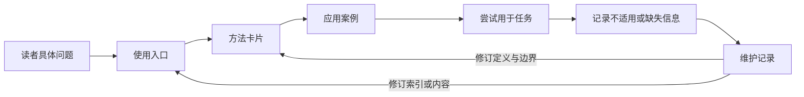

# 示例：从背景到架构

以下为虚构的知识库建设任务，说明工作架构如何帮助开工。它不是实际用户调研或效果评测。

## 背景与信息

目标：帮助新同事选择并正确使用思考方法。已有一批笔记，但定义、案例和来源混在一起。约束：先用 Markdown，维护时间有限；不预设需要网站或数据库。

需核实：新同事通常按名称还是按问题查找？最常见的任务是什么？在取得反馈前，将“按问题查找更方便”保留为假设。

## 最小结构与职责

```text
知识库/
├── README.md       使用入口与问题索引
├── 方法/           定义、步骤、边界与来源
├── 案例/           方法在具体任务中的用法
└── 维护记录.md     已核验、待补证与后续动作
```

| 部分 | 输入 | 职责与输出 | 边界 |
|---|---|---|---|
| 使用入口 | 读者任务、方法概览 | 帮助定位候选方法 | 不复制全部卡片 |
| 方法 | 原始资料与核验结果 | 说明如何使用及何时不适用 | 不把案例结果当普遍规律 |
| 案例 | 具体问题与方法 | 展示推理、行动和限制 | 不冒称虚构数据为真实结果 |
| 维护记录 | 缺口与反馈 | 指向补证和改进动作 | 不代替内容本身 |

## 关系与执行



文字路径：问题 → 入口 → 方法 → 案例 → 使用 → 反馈修订。箭头表示使用路径和维护反馈；来源在方法卡片中保留直接入口。

先核验一张高频方法卡，配一个示例，再检查读者能否找到并解释适用边界。通过后扩展到更多方法。若已有项目包含合适目录，就沿用已有位置，避免为统一外观重排所有文件。

## 验收与调整

- 结构检查：入口链接可达，每个目录有明确用途，没有空占位。
- 内容检查：定义有来源，示例标注状态，步骤和图一致。
- 使用验证：读者完成查找与选择任务，记录误解；未测试前不报告效率提高。
- 调整条件：读者主要按名称查找时补名称索引；只有出现实际跨文件关联需求时再评估额外工具。

来源与方法依据见[工作架构规范](../../规范/工作架构.md)。目录、职责表和执行安排均为本示例设计。
